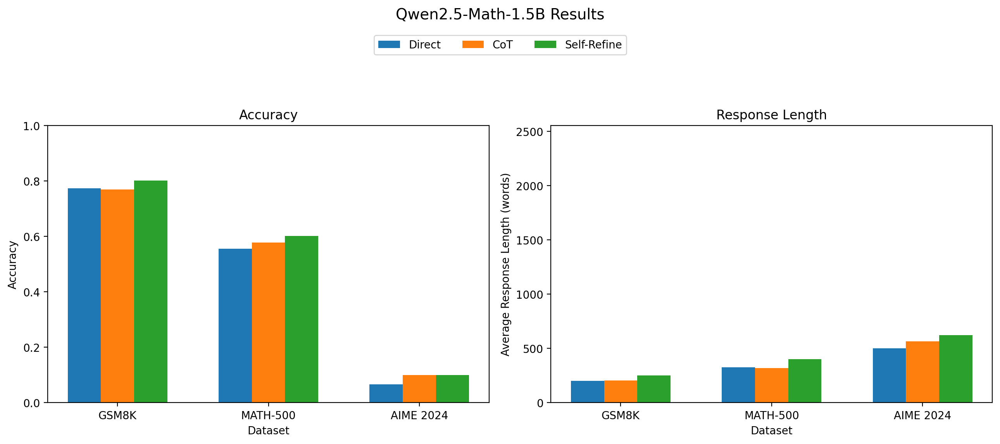
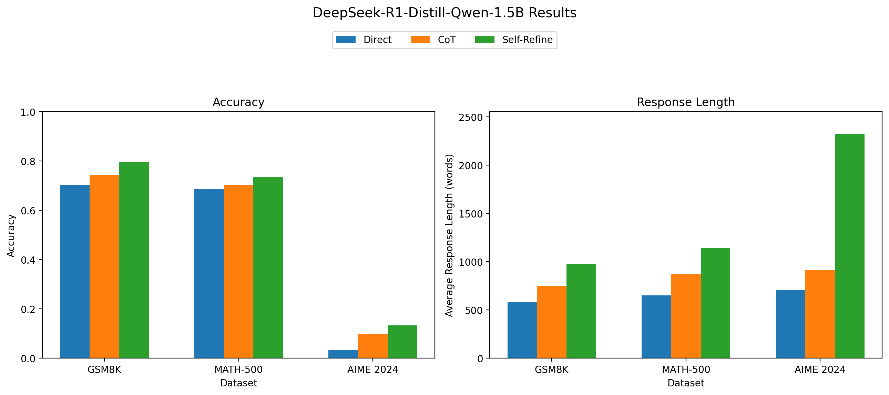

# LLM Mathematical Reasoning Evaluation

A reproducible benchmark for comparing prompting strategies on open-source mathematical reasoning models. The project evaluates **Direct**, **Chain-of-Thought (CoT)**, and **Self-Refine** prompting on GSM8K, MATH-500, and AIME 2024.

## Highlights

- Two compact reasoning models: Qwen2.5-Math-1.5B and DeepSeek-R1-Distill-Qwen-1.5B
- Three prompting strategies with one answer extraction and scoring pipeline
- Per-example JSON outputs and a machine-readable result summary
- Accuracy and response-length comparisons
- A configurable command-line interface for smoke tests and full runs

## Results

Accuracy from the recorded full experiment:

| Model | Dataset | Direct | CoT | Self-Refine |
|---|---:|---:|---:|---:|
| Qwen2.5-Math-1.5B | GSM8K | 77.33% | 76.95% | **80.12%** |
| Qwen2.5-Math-1.5B | MATH-500 | 55.60% | 57.80% | **60.20%** |
| Qwen2.5-Math-1.5B | AIME 2024 | 6.66% | **10.00%** | **10.00%** |
| DeepSeek-R1-Distill-Qwen-1.5B | GSM8K | 70.40% | 74.30% | **79.61%** |
| DeepSeek-R1-Distill-Qwen-1.5B | MATH-500 | 68.60% | 70.40% | **73.60%** |
| DeepSeek-R1-Distill-Qwen-1.5B | AIME 2024 | 3.33% | 10.00% | **13.32%** |

Self-Refine produced the highest recorded accuracy in most comparisons, but also generated substantially longer responses—especially for DeepSeek on AIME 2024. See [`results/summary.csv`](results/summary.csv) for all metrics.





## Repository structure

```text
.
├── project.py          # Loading, generation, extraction, and evaluation
├── visualization.py    # Charts generated from results/summary.csv
├── requirements.txt    # Python dependencies
└── results/
    ├── summary.csv     # Structured metrics used by the charts
    ├── *.json          # Available per-example outputs
    └── *_results.png   # Generated comparison charts
```

## Setup

Python 3.10+ and a CUDA-capable GPU are recommended. CPU execution is possible but slow.

```bash
python -m venv .venv
# Windows PowerShell
.venv\Scripts\Activate.ps1
pip install -r requirements.txt
```

Model weights and datasets are downloaded from Hugging Face on first use.

## Usage

Start with a small smoke test:

```bash
python project.py --models Qwen/Qwen2.5-Math-1.5B --datasets gsm8k_test --methods direct --max-samples 5 --max-new-tokens 512 --output-dir results/smoke
```

Run the complete default experiment:

```bash
python project.py
```

Generation uses greedy decoding by default for reproducibility. Add `--sample` for temperature sampling. Use `python project.py --help` to see all options.

Regenerate figures from the checked-in summary:

```bash
python visualization.py
```

Run the answer-processing tests:

```bash
python -m unittest discover -s tests -v
```

## Evaluation details

The evaluator extracts explicit `Final answer:`/`Answer:` text or the last LaTeX `\boxed{...}` expression. It normalizes common LaTeX wrappers and compares integers, decimals, simple fractions, and tuples. Response length counts whitespace-separated words. Self-Refine length includes the initial solution, critique, and final solution.

Exact-match evaluation can undercount mathematically equivalent symbolic expressions. For rigorous comparisons, manually audit borderline cases or replace the scorer with a symbolic equivalence checker.

## Reproducibility notes

- Default seed: `42`
- Default decoding: greedy
- Default maximum generation length: 4,000 tokens
- Dataset splits: GSM8K `test`, MATH-500 `test`, AIME 2024 `train`
- Result JSON records raw output, extracted prediction, correctness, and response length

The structured summary reflects the recorded experiment log. Some checked-in detailed JSON files are partial or were rescored separately, so recomputing metrics from only the currently available JSON files may not reproduce every summary cell.
